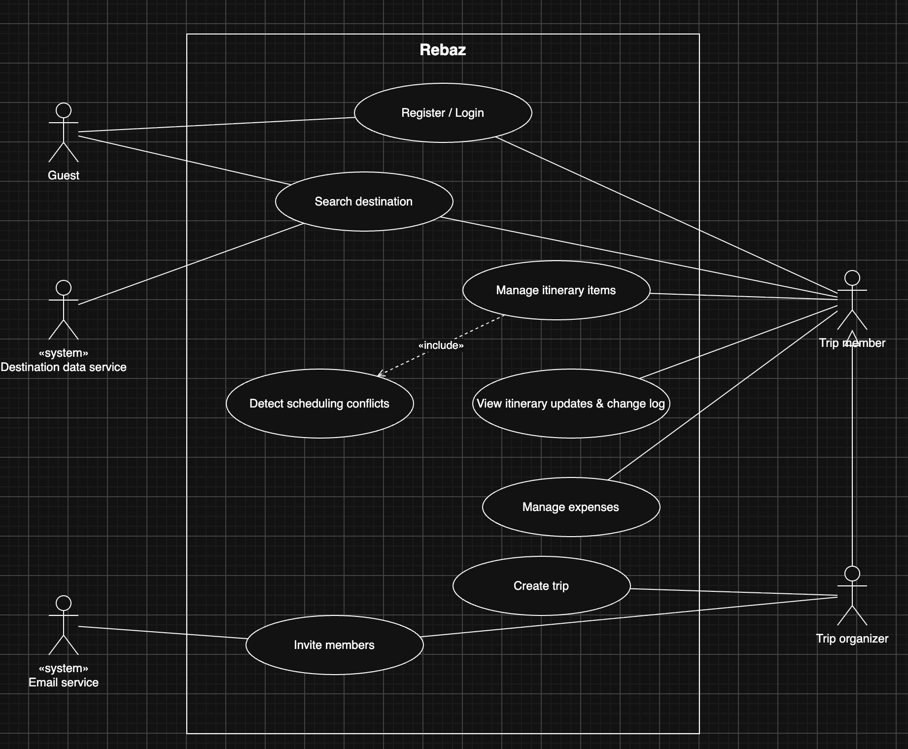
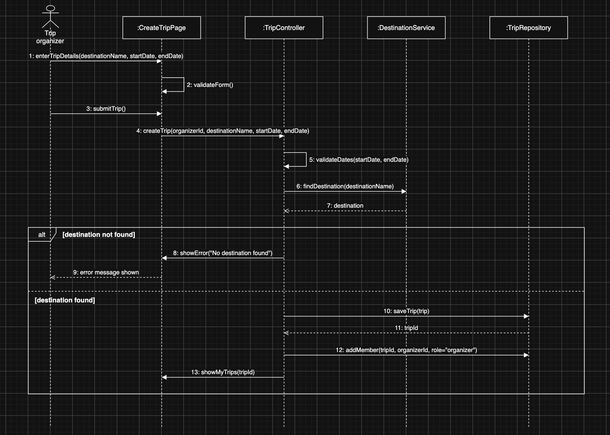
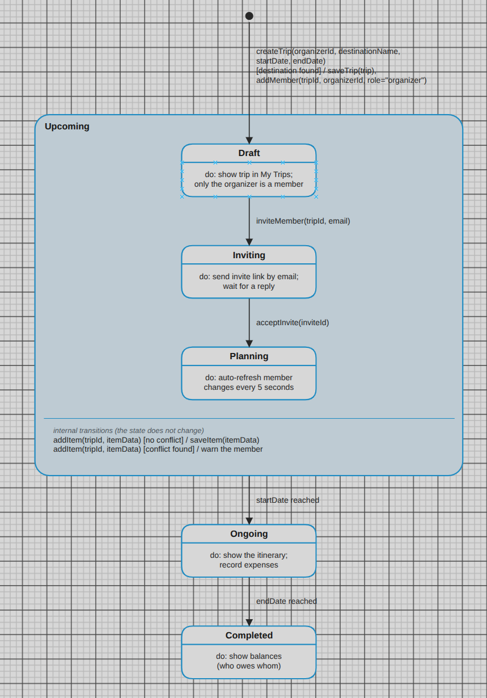
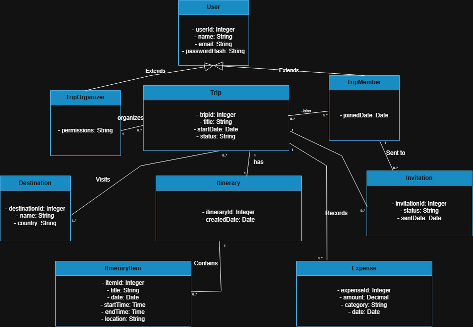
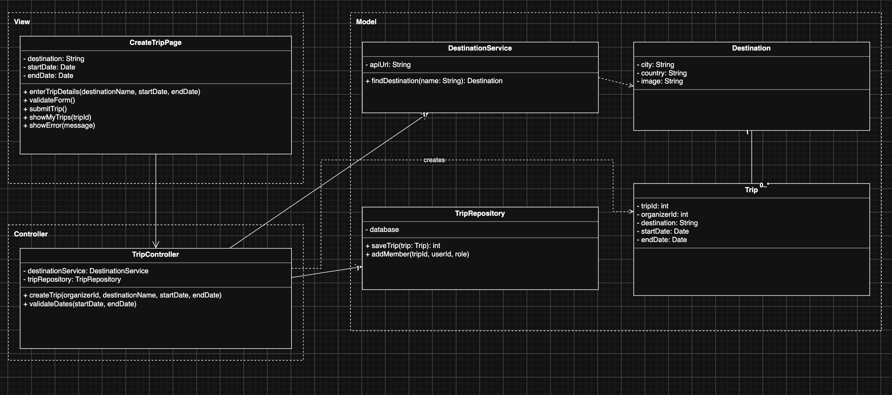

## Selected user stories

| ID | User Story |
|---|---|
| US1 | As users, we'd like to create an account and log in so that we can securely access our trips. |
| US2 | As users, we'd like to create a trip so that we can organize travel with other members. |
| US3 | As a trip organizer, I want to search for destinations and invite members so that we can plan together. |
| US4 | As a trip member, I want to add, edit, delete, and view itinerary items so that the trip schedule stays organized. |
| US5 | As a trip member, I want the system to detect scheduling conflicts so that overlapping activities can be avoided. |
| US6 | As a trip member, I want to record expenses and view equal splits and balances so that everyone knows what they owe. |
| US7 | As a trip member, I want to see itinerary updates and a changelog so that I know what other members have changed. |

| Item | Selection |
|---|---|
| Key feature | Creating a trip |
| Lifecycle object | Trip |
| UML tool | Draw.io |

## Task 1: Use Case Diagram for Rebaz Travel Planning System

1. A Guest, Trip Organizer, or Trip Member can register or log in.

2. The Trip Organizer can create a trip.

3. The Trip Organizer can search for destinations.

4. The Trip Organizer can invite members.

5. The Trip Organizer and Trip Members can manage itinerary items.

6. Managing itinerary items includes detecting scheduling conflicts.

7. Trip Members can manage trip expenses.

8. Trip Members can view itinerary updates and the change log.

**Figure 4.1: Use Case Model**

| Field | Entry |
|---|---|
| Actors | Trip organizer |
| Description | Allows a trip organizer to create a new trip by entering its destination, start date, and end date. |
| Data | Organizer ID, destination, start date, end date, trip ID. |
| Stimulus | The organizer enters the trip details and presses the Create Trip button. |
| Response | The system validates it, saves the trip and displays it. |
| Comments | The organizer must be logged in. Required fields must be completed, and invalid information must be rejected. |

## Task 2: Sequence Diagram

**Figure 4.2: Sequence Diagram**

You can read this diagram as follows:

1. The trip organizer enters a destination name, a start date and an end date on the Create Trip page.

2. The page checks that every required field is filled, and only then enables the Create trip button (US-02 AC1).

3. The organizer submits the trip.

4. The page sends createTrip to the TripController with the organizer's ID and the form data.

5. The controller checks that the end date is not before the start date.

6. The controller asks the DestinationService to look up the destination, and the service returns the result.

7. If the destination is found, the controller saves the trip through the TripRepository, which returns the new trip ID.

8. The controller adds the organizer to the trip as a member with the role "organizer".

9. The controller tells the page to show the new trip in My Trips, and the organizer sees it there (US-02 AC2).

10. If the destination is not found, the controller tells the page to show "No destination found" (US-01 AC2), and no trip is created.

## Task 3: State Machine Diagram

**Figure 4.3: State Machine Diagram**

1. When the organizer submits the Create Trip form (createTrip(organizerId, destinationName, startDate, endDate), message 4 in Figure P4.2), the new trip starts in the Draft state and appears in My Trips (US2). The organizer is added as its only member. If the destination is not found, no trip is created, so the trip never enters this diagram.

2. When the organizer sends an invitation with inviteMember(tripId, email), the trip moves to Inviting (US3). The invitation link is sent by email, and the trip waits for a response. Sending further invitations does not change the state. If the same person is invited twice, the system shows that they are already a member (P2, US-03 AC2).

3. When the first invited person accepts the invitation using acceptInvite(inviteId), they join the trip as a member, and the trip moves to Planning. In Planning, members see each other's changes through automatic refreshes every 5 seconds (P3, task T7, which replaced real-time updates; US7). Further acceptances do not change the state.

4. Draft, Inviting, and Planning are grouped under the Upcoming superstate because they share the same behaviour. When the start date is reached, the trip moves to Ongoing, regardless of which of the three states it is in. Even if the organizer is the only member, they can add itinerary items (P2, O1). When a member uses addItem(tripId, itemData), the system either saves the item if there is no conflict or warns the member if a scheduling conflict is found (US4, US5; P2, O3). Neither outcome changes the trip's state. These transitions are drawn once inside the superstate instead of repeating them for all three states.

5. While the trip is Ongoing, members follow the itinerary and record expenses (US6). When the end date is reached, the trip moves to Completed, where the balances show who owes whom (P2, O5). Completed is the final state of the life cycle because P2 does not include a feature to cancel or delete a trip, so no final state is drawn.

### States

| State | Description | Events that move the trip out of this state |
|---|---|---|
| Upcoming (superstate) | Groups Draft, Inviting and Planning. The trip exists but has not started yet. | startDate reached → Ongoing |
| Draft | Trip saved and listed in My Trips. The organizer is the only member. | inviteMember(tripId, email) → Inviting, + the Upcoming event |
| Inviting | Invite link sent by email. Waiting for an invited person to accept. | acceptInvite(inviteId) → Planning, + the Upcoming event |
| Planning | At least one invited person has joined. Changes appear by 5 second auto refresh. | Only the Upcoming event |
| Ongoing | The start date has arrived. Members follow the itinerary and record expenses. | endDate reached → Completed |
| Completed | The end date has passed. The balances show who owes whom. | None: last state of the life cycle. |

### Stimuli

| Stimulus | Description |
|---|---|
| createTrip(organizerId, destinationName, startDate, endDate) | The organizer submits the Create trip form. It is accepted only if the destination is found. |
| inviteMember(tripId, email) | The organizer sends an invite link to a person's email. |
| acceptInvite(inviteId) | An invited person opens the link and accepts the invitation. |
| addItem(tripId, itemData) | A member adds an itinerary item. It is saved only if it does not clash with another item. |
| startDate reached | Clock event: the current date becomes the trip's start date. |
| endDate reached | Clock event: the current date passes the trip's end date. |

## Task 4: Class Diagrams

**Figure 4.4: Domain Model**

**Figure 4.5: Design Level Class Diagram**

## Task 5:

### 5.1 Consistency checks

| Check | Where in your models | Result (OK/fixed) |
|---|---|---|
| Every sequence message arriving at an object is an operation of its class. | Task 2 → Task 4b | OK |
| Every event in the state diagram is a message or system/user action elsewhere. | Task 3 → Tasks 1, 2 | Fixed |
| Every use case traces to at least one user story. | Task 1 → P2 | OK |
| Every domain class appears in at least one use case or related interaction. | Task 4a → Task 1 | OK |
| The Create Trip use case matches the main sequence diagram. | Task 1 → Task 2 | OK |
| The Trip object in the state diagram matches the Trip class in the domain model. | Task 3 → Task 4a | OK |
| The Trip class contains the information needed to create a trip. | Task 2 → Task 4a, 4b | OK |
| The system supports multiple members participating in a trip. | Task 1 → Task 4a | OK |
| The itinerary item subclasses inherit from the main ItineraryItem class. | Task 4a | OK |

### 5.2 Justifications

**Ahmed:** To keep the design work focused, I chose not to create separate activity, component, deployment, or data-flow models. The project is still at the design stage, so deployment details such as servers and network nodes would add little value. A component diagram would also repeat information already shown in the design-level class diagram. I kept the use case diagram small by including only the main actors and important system functions instead of every minor action. The sequence diagram focuses only on adding an itinerary item because it is the key feature selected for the project. Similarly, the state machine models only the Trip lifecycle, while the domain model is limited to nine essential classes. These models are enough to explain user interactions, message flow, object states, and the system's static structure. Following Sommerville's advice, limiting the number and size of models reduces development time and avoids creating diagrams that repeat information without supporting useful design decisions.

**Clyan:** For the Rebaz system, we selected use case, sequence, and class diagrams because they provide important information about the system's functionality, interactions, and structure. We focused on the Create Trip feature because it is one of the main functionalities of Rebaz and provides the foundation for other features, such as inviting members, managing itineraries and recording expenses. We did not create activity diagrams because the sequence diagram already explains the main workflow of creating a trip, including the alternative validation scenario. We also limited the design level class diagram to the classes involved in trip creation rather than modelling every class in the application. This keeps the diagram clear and focused. We did not create deployment or component diagrams because they were not necessary for demonstrating our selected feature at this stage. Following Sommerville's recommendation, we chose models that provide useful design information without adding unnecessary complexity.

**Dara:** We chose to draw only the models that would directly help us build Rebaz. We did not draw an activity diagram, because the Create trip flow is short, and the sequence diagram already shows both the main path and the error case in its alt box. We also skipped a separate context diagram, since the use case diagram already shows the system boundary and the external systems (email and destination data). We drew only one sequence diagram, for the key feature, because other features such as inviting members and expenses follow the same view, controller and model pattern. The design class diagram was kept small on purpose: it only includes the classes that appear in the Create trip sequence, without return types or extra attributes. Our P3 plan showed that our work almost fills our time budget, so following Sommerville's advice, we kept modelling minimal and saved time for implementation.

**Makan:** For task 3 I only drew a state diagram for the Trip. It's the one thing in Rebaz that has a real life cycle. It is created, shared, planned, taken and finished, and it reacts differently to events at each stage. I did not draw state diagrams for invitations, itinerary items or expenses. They mostly store data, so a state diagram would add little for the extra time. I also kept the trip diagram small. It has five states and one superstate, Upcoming, which groups Draft, Inviting and Planning. Those three states share the same exit, startDate reached, and the same item events, so drawing them once on the superstate replaces nine separate arrows. I did not draw editing and deleting items as separate events, because they leave the trip in the same state as adding an item. I left out states and events that our P2 requirements and P3 plan do not contain. Declining an invitation is not in any model, so I removed that too. Realtime updates were cut in P3, so Planning shows a 5 second auto refresh instead.

## Contributions

| Team member | Contribution / Task completed | Contribution (%) |
|---|---|---|
| Ahmed | Task 4a | 100% |
| Clyan | Task 2 | 100% |
| Dara | Task 4b | 100% |
| Makan | Task 3 | 100% |
| Mohammed | Task 1 | 100% |
